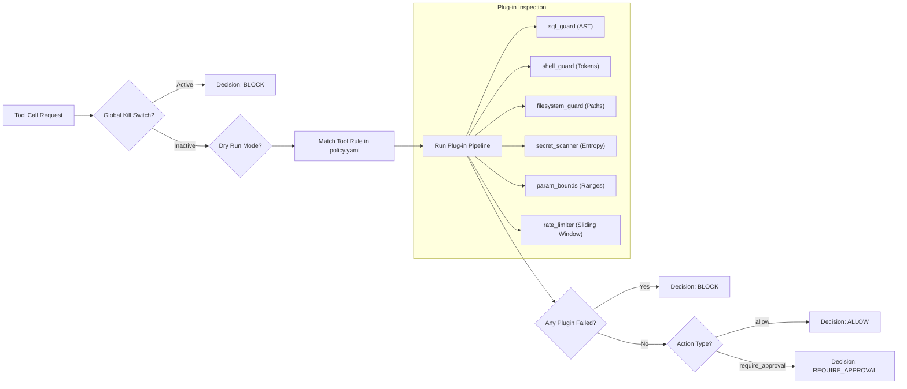

<p align="left">
  
</p>

# AgenVe2: AI Agent Execution Firewall

Deterministic, policy-as-code runtime security for autonomous AI models, coding agents, and multi-agent workflows.

AgenVe2 intercepts and evaluates tool calls in sub-3ms latency using native Abstract Syntax Tree (AST) parsing before destructive operations touch databases, filesystems, shell processes, or external APIs.

---

## Overview

Modern AI agents are equipped with execution tools: database drivers, terminal sessions, filesystem handles, and API integrations. While foundation models provide reasoning capabilities, they are probabilistic and lack execution boundaries.

Existing safety solutions focus on prompt inspection (evaluating conversational text before it reaches the model). **AgenVe2 operates at the execution layer** (evaluating system actions before they reach the infrastructure).

```
[ User / Trigger ]
       │
       ▼
[ AI Agent Engine ] ──── (LLM Reasoning: Claude, GPT, DeepSeek, Local Ollama)
       │
       ▼ Tool Call Request (JSON-RPC / Function Arguments)
╔════════════════════════════════════════════════════════════════════════╗
║                        AGENVE2 EXECUTION FIREWALL                         ║
║  • Latency: < 3 ms per evaluation (In-Memory, Deterministic)           ║
║  • No LLM Required: C-accelerated AST parsers, regex tokenizers        ║
║  • Decision Engine: ALLOW | BLOCK | REQUIRE_APPROVAL                   ║
╚════════════════════════════════════════════════════════════════════════╝
       │
       ├───────────────────────────────┬───────────────────────────────┐
       ▼ [ALLOW]                       ▼ [REQUIRE_APPROVAL]            ▼ [BLOCK]
[ Real Tool Executes ]       [ Web Console Approval Dock ]    [ Synthetic Error Returned ]
(Database, Shell, Disk, API) (Operator Sign-off: :8080)       (Execution Aborted at Kernel)
```

### Key Differentiators

* **Deterministic Latency (< 3ms):** Evaluates operations via native C/Python AST parsers without invoking LLM-as-a-judge roundtrips, eliminating evaluation costs and hallucinated approvals.
* **Fail-Closed Architecture:** Unmapped tools or unhandled parameter schemas default to `BLOCK` under standard and strict policies.
* **Zero Model Dependencies:** Agnostic to the underlying model. Secures local uncensored models (Ollama, vLLM, llama.cpp), enterprise APIs (Anthropic, OpenAI, Google), and coding environments (Antigravity, Cursor, Claude Code).
* **Policy as Code:** All execution boundaries are versioned, declarative YAML configurations (`policy.yaml`) with hot-reload support.

---

## Where AgenVe2 Is Used

AgenVe2 is designed for environments where autonomous agents interact with critical tools and real-world side effects.

### 1. Autonomous Coding Agents & Developer Workflows
* **Target Platforms:** Antigravity IDE, Claude Code, Cursor, Aider, OpenHands.
* **Protection Scope:**
  * Blocks destructive shell commands (`rm -rf`, `mkfs`, `dd`, fork bombs).
  * Enforces Git branch protection (blocks `git push --force` and direct commits to protected branches).
  * Quarantines sensitive files (blocks reads, writes, and logging of `.env*`, `id_rsa`, and credential stores).
  * Eliminates alert fatigue by silently auto-approving safe operations (`git status`, `pytest`, reading documentation).

### 2. Database & Analytical Operations
* **Target Platforms:** PostgreSQL, MySQL, SQLite, Snowflake, ClickHouse.
* **Protection Scope:**
  * Enforces statement-type allowlists (e.g., strictly `SELECT`).
  * Blocks destructive Data Definition Language (DDL) operations (`DROP TABLE`, `ALTER TABLE`, `TRUNCATE`).
  * Detects and aborts stacked SQL injection payloads (`SELECT * FROM users; DROP TABLE orders;`).
  * Enforces row limits on queries to prevent unindexed table scan locks.

### 3. DevOps & Cloud Infrastructure Management
* **Target Platforms:** Docker, Kubernetes (K3s), Coolify, Portainer, Dokku.
* **Protection Scope:**
  * Prevents unauthorized container destruction (`docker rm -f`, `kubectl delete namespace`).
  * Blocks binding unauthenticated services to `0.0.0.0` or reserved host ports.
  * Restricts subprocess execution to verified binary allowlists.

### 4. E-Commerce, Billing & Financial Operations
* **Target Platforms:** Medusa, Saleor, Kill Bill, Stripe integration agents.
* **Protection Scope:**
  * Enforces hard transaction caps (e.g., maximum refund parameter `<= $100.00`).
  * Halts ledger-altering operations for human authorization via the approval dock.
  * Blocks invalid price mutations (e.g., setting product costs to `$0.00`).

### 5. Content Publishing & Marketing Automation
* **Target Platforms:** Postiz, Ghost, Strapi, social media publisher agents.
* **Protection Scope:**
  * Rate-limits outbound publishing calls to prevent API quota exhaustion and account suspension.
  * Routes public-facing broadcasts (social posts, mass newsletters) to the approval queue before broadcast.
  * Restricts content edits to designated draft directories.

### 6. Customer Communications & Support Operations
* **Target Platforms:** Novu, Chatwoot, Mattermost, Twilio gateways.
* **Protection Scope:**
  * Throttles bulk notification dispatches to prevent spam cascades.
  * Automatically detects and redacts PII and internal access keys from outbound replies.
  * Enforces per-minute recipient caps on automated communications.

---

## Architecture and Core Plugins

AgenVe2 uses a modular microkernel architecture with a pipes-and-filters execution pipeline:



### Security Plug-in Capabilities

* **`sql_guard`:** Full AST parsing via `sqlglot`. Validates SQL dialect syntax, restricts statement types, strips comments, inspects nested subqueries, and prevents multi-statement injections.
* **`shell_guard`:** Lexical parsing of command strings. Disallows shell chaining operators (`&&`, `;`, `||`, `|`), verifies execution binaries against allowlists, and inspects command flags.
* **`filesystem_guard`:** Path resolution and canonicalization. Prevents directory traversal (`../`), verifies target paths against allowed roots, and denies access to secret glob patterns.
* **`secret_scanner`:** Scans tool call payloads using regex and Shannon entropy algorithms to catch API tokens (OpenAI, Anthropic, AWS, GitHub, private keys) and automatically redacts them before logging.
* **`param_bounds`:** Validates argument types, numeric bounds (`min`, `max`), string lengths, and array item counts.
* **`rate_limiter`:** Enforces sliding-window request-per-minute quotas per tool to halt infinite agent loops.

---

## Integration Modes

AgenVe2 integrates at multiple layers of the application stack:

### Option A: Model Context Protocol (MCP) Stdio Proxy
Wrap any MCP server binary in your client configuration (`mcp.json`):

```json
{
  "mcpServers": {
    "secure-postgres": {
      "command": "agenve2",
      "args": ["proxy", "--policy", "./policy.yaml", "--", "npx", "@modelcontextprotocol/server-postgres"]
    }
  }
}
```

### Option B: Python Function Decorator SDK (`@agenve2.guard`)
Protect standalone Python functions or agent tools with a single decorator:

```python
from agenve2 import AgenVe2Client

agenve2 = AgenVe2Client(policy="./policy.yaml")

@agenve2.guard("postgres_query")
def execute_database_query(query: str) -> list:
    return db.execute(query).fetchall()
```

### Option C: Universal Agent Loop / Framework Middleware
Integrate into any custom agent loop, LangChain, CrewAI, AutoGen, LlamaIndex, or raw LLM function calling:

```python
from agenve2 import AgenVe2Client

agenve2 = AgenVe2Client(policy="./policy.yaml")

# Evaluate tool call before executing
decision = agenve2.evaluate(
    tool_name=tool_call.name,
    arguments=tool_call.arguments,
)

if decision["effective_decision"] == "BLOCK":
    return f"Security Error: {decision['reason']}"

# Safe to execute tool
return run_tool(tool_call)
```
*(See `examples/quickstart_demo.py` for a complete runnable demonstration.)*

---

## Quickstart

### 1. Installation

```bash
uv sync --dev
```

### 2. Initialize Policy

Generate a starter policy:

```bash
uv run agenve2 init --preset standard
```

This creates a declarative `policy.yaml` file:

```yaml
version: "1"
mode: enforce

defaults:
  action: deny
  approval_timeout_seconds: 120

rules:
  postgres_query:
    action: allow
    plugins:
      - name: sql_guard
        allow_statements: [SELECT]
        max_limit: 500

  read_file:
    action: allow
    plugins:
      - name: filesystem_guard
        allowed_roots: ["."]
        denied_patterns: [".env*", "*.pem", "**/.ssh/**"]

  run_shell:
    action: allow
    plugins:
      - name: shell_guard
        allowed_commands: [git, pytest, uv, npm]
        block_chaining: true

  refund_customer:
    action: require_approval
    plugins:
      - name: param_bounds
        bounds:
          amount:
            min: 0.0
            max: 100.0
```

### 3. Start the AgenVe2 Daemon and Dashboard

```bash
uv run agenve2 start --policy policy.yaml
```

The daemon starts the evaluation gateway and serves the web console at `http://localhost:8080`.

---

## Web Console and Management Dashboard

The AgenVe2 management console provides operational visibility and runtime control:

* **Execution Timeline:** Real-time event stream tracking every tool evaluation, latency measurement, and policy match.
* **Approval Dock:** Asynchronous review queue for actions flagged as `require_approval`. Operators can inspect full JSON payloads and choose **Approve**, **Deny**, or **Deny with Feedback**.
* **Global Kill Switch:** One-click emergency freeze that instantly halts all tool executions across all connected agents.
* **Policy Simulator:** Test candidate policies against simulated tool requests without impacting running agents.
* **Audit Trail:** Tamper-evident, SQLite WAL-backed execution history with cryptographic hash verification and JSON/CSV export.

---

## CLI Reference

| Command | Description |
| :--- | :--- |
| `agenve2 init` | Initialize a starter `policy.yaml` (`--preset strict\|standard\|permissive`) |
| `agenve2 start` | Launch the evaluation daemon and web console |
| `agenve2 start --dry-run` | Shadow mode: evaluates and logs policy matches without blocking execution |
| `agenve2 proxy -- <command>` | Transparently proxy standard I/O for MCP servers |
| `agenve2 eval --tool <name> --args '<json>'` | Evaluate an individual tool call payload against policy |
| `agenve2 check` | Validate `policy.yaml` syntax and rule configurations |
| `agenve2 logs --blocked` | Query recent blocked execution attempts from the audit store |
| `agenve2 audit verify` | Verify cryptographic hash integrity of stored audit records |
| `agenve2 kill` | Activate the global kill switch |
| `agenve2 kill --unlock` | Deactivate the global kill switch |

---

## Performance Benchmark

Measured on standard workstation hardware (Python 3.14 / CPython runtime, in-memory evaluation):

| Test Case | Engine | Latency | Result |
| :--- | :--- | :--- | :--- |
| `SELECT id FROM users LIMIT 10` | SQL AST Parser (`sql_guard`) | 2.11 ms | ALLOW |
| `DROP TABLE users CASCADE;` | SQL AST Parser (`sql_guard`) | 1.87 ms | BLOCK |
| `read_file(".env")` | Path Sandbox (`filesystem_guard`) | 2.66 ms | BLOCK |
| `run_shell("git status")` | Shell Lexer (`shell_guard`) | 1.78 ms | ALLOW |
| `run_shell("rm -rf /")` | Shell Lexer (`shell_guard`) | 1.94 ms | BLOCK |
| `refund_customer(amount=5000)` | Boundary Engine (`param_bounds`) | 1.79 ms | BLOCK |

---

## Tech Stack

* **Core Runtime:** Python 3.11+, Pydantic v2, Typer, Rich
* **Parsing & Security:** `sqlglot` (SQL AST), Python `tokenize` / `shlex`, `pathlib`
* **Server & Gateway:** FastAPI, Uvicorn, WebSockets
* **Storage:** SQLModel, SQLite (WAL mode), optional PostgreSQL backend
* **Dashboard Frontend:** React 19, Vite, TypeScript, Tailwind CSS, Lucide Icons

---

## License

Apache-2.0
