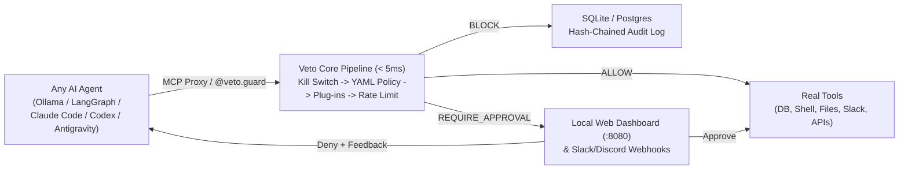

# 🛡️ Veto

**An open-source, Python-native AI Agent Execution Firewall.**  
Control, audit, and approve what **any AI agent** (local uncensored LLMs, custom Python/LangGraph workflows, or MCP coding agents like Claude Code, Codex, Cursor, and Antigravity) can actually execute on your machine or company infrastructure.

> **Why Veto?**  
> An LLM is just a *brain*. An AI Agent has *hands* (databases, shell, filesystem, Slack, APIs). Even safety-trained cloud models make overeager mistakes—and local/uncensored models have zero built-in cautions. **Veto sits on the hands**, enforcing deterministic, fail-closed policies in **< 5 ms** with zero LLM or GPU required.

---

## ✨ Key Features

- **Model-Agnostic & Zero-LLM Core** — Works identically with local uncensored models (Ollama, vLLM, Llama, Qwen, DeepSeek) and cloud APIs (OpenAI, Claude, Gemini). Never asks for your LLM API keys.
- **Policy-as-Code (`policy.yaml`)** — Human-readable, Git-friendly rules with hot-reload and **fail-closed** defaults (`allow` | `deny` | `require_approval`).
- **Microkernel Security Plug-ins** — Built-in deep inspection:
  - `sql_guard` — Real SQL AST parsing via `sqlglot` (`SELECT`-only enforcement, stacked injection blocking, row limits).
  - `shell_guard` — Command allowlists + shell-chaining protection (`&&`, `;`, `|`, `rm -rf`, `sudo`).
  - `filesystem_guard` — Directory sandboxing against `../` traversal and `.env` / `.ssh` protection.
  - `secret_scanner` — Regex + entropy scanning & automatic redaction before logs hit disk.
  - `param_bounds` — Strict numeric/size caps (e.g., `refund_amount <= 500`, `max_recipients <= 5`).
  - `rate_limiter` — Loop-breaker to stop runaway agents.
- **Human-in-the-Loop Approvals** — Pauses risky actions cleanly (`asyncio`) until an operator clicks **Approve**, **Deny**, or **Deny with Feedback** in the Web Dashboard (`localhost:8080`) or via Slack/Discord webhooks.
- **Emergency Global Kill Switch** — 1-click freeze across all connected agents (persisted across restarts).
- **Tamper-Evident Persistent Audit Trail** — Local **SQLite (WAL mode)** hash-chained logs (`~/.veto/audit.db`) with CSV/JSON export—swappable to **PostgreSQL** via 1 `DATABASE_URL` env variable.
- **Plug-in Everywhere** — Transparent **MCP stdio Proxy** (`veto proxy -- <cmd>`), 1-line **Python `@veto.guard` SDK**, **Docker** deployment, and a native **Antigravity Plugin** bundle (`plugins/veto/`).

---

## 🏗️ Architecture

**Microkernel (Plug-in) Modular Monolith** + **Pipes-and-Filters Pipeline** + **Hexagonal (Ports & Adapters)**:



---

## ⚡ 2-Minute Quickstart

### 1. Install & Initialize
```bash
uv sync --dev
uv run veto init               # creates policy.yaml
```

### 2. Define Your Rules (`policy.yaml`)
```yaml
version: "1"
mode: enforce
defaults:
  action: deny
  approval_timeout_seconds: 120

rules:
  postgres_query:
    action: allow
    plugins:
      - name: sql_guard
        allow_statements: [SELECT]
        max_limit: 500

  read_file:
    action: allow
    plugins:
      - name: filesystem_guard
        allowed_roots: ["."]
        denied_patterns: [".env*", "*.pem", "**/.ssh/**"]

  slack_post:
    action: require_approval
```

### 3. Start Veto & Open the Dashboard
```bash
uv run veto start
# 🛡️ Veto Firewall active at http://localhost:8080
```

### 4. Connect Any Agent

**Option A — MCP Proxy (Claude Code, Codex, Antigravity, Cursor, Ollama MCP):**
Wrap any MCP server command in your `mcp.json` with `veto proxy --`:
```json
{
  "mcpServers": {
    "veto-postgres": {
      "command": "veto",
      "args": ["proxy", "--policy", "./policy.yaml", "--", "npx", "@modelcontextprotocol/server-postgres"]
    }
  }
}
```

**Option B — 1-Line Python SDK (Custom Agents, LangGraph, CrewAI, Ollama):**
```python
from veto import guard

@guard(policy="./policy.yaml")
def postgres_query(query: str):
    return db.execute(query)
```

---

## 💻 CLI Reference

| Command | Description |
| :--- | :--- |
| `veto init` | Create a starter `policy.yaml` (`--preset strict\|coding\|data`) |
| `veto start` | Launch Veto gateway, live logs, and Web Dashboard (`http://localhost:8080`) |
| `veto start --dry-run` | Shadow mode: log what *would* be blocked without stopping the agent |
| `veto proxy -- <cmd>` | Transparently wrap any `stdio` MCP server |
| `veto test --tool ... --args ...` | Simulate a tool call against `policy.yaml` without running an LLM |
| `veto check` | Validate `policy.yaml` syntax in CI or before committing to Git |
| `veto logs --blocked` | Inspect recent blocked threats from SQLite |
| `veto audit verify` | Verify SHA-256 hash-chain integrity of audit logs |
| `veto kill` / `veto kill --unlock` | Toggle the Global Kill Switch |

---

## 🖥️ Local Web Dashboard (`http://localhost:8080`)

Compiled as a static **React (Vite) + TypeScript + Tailwind** SPA served directly by FastAPI (zero Node.js required for end users):
1. **Top Control Bar**: Live status, **Global Kill Switch**, Enforce/Dry-Run toggle, KPIs.
2. **Pending Approvals Inbox**: Real-time WebSocket approval cards with countdown timer, formatted SQL/JSON preview, and **Approve / Deny / Deny with Feedback**.
3. **Live Activity Feed & Inspector**: Streaming log table with slide-out JSON & rule details.
4. **Policy & Rule Simulator**: Plug-in toggles, `policy.yaml` editor with hot-reload, and dry-run tester.
5. **Audit Export**: Persistent SQLite history with 1-click CSV/JSON export.

---

## 🧩 Tech Stack

- **Backend & CLI**: Python 3.11+, FastAPI, Uvicorn, WebSockets, Typer, Rich, Pydantic v2
- **Security Parsers**: `sqlglot` (SQL AST), `shlex`, `pathlib`, entropy secret scanning, `cachetools`
- **Storage**: SQLModel + SQLite (WAL mode) — 1-line `DATABASE_URL` swap to PostgreSQL
- **Frontend Dashboard**: React + Vite + TypeScript + Tailwind CSS + Lucide Icons
- **Antigravity Plugin**: Bundled in `plugins/veto/` (`plugin.json`, `mcp_config.json`, `skills/`, `rules/`)

## 📄 License
Apache-2.0
